<div align="center">

<picture>
  <source media="(prefers-color-scheme: dark)" srcset="assets/logo/code-graph-logo-dark.svg">
  
</picture>

# code-graph

[](https://ko-fi.com/J3K52ADG60)

**Analisi locale del codice per 8 linguaggi e SQLite SQL.**<br>
Chiedi al tuo coding agent dove intervenire, cosa potrebbe essere coinvolto e quali test lanciare.

[](https://github.com/dagoSte/code-graph/releases/latest) [](LICENSE.md) [](#install) [](#mcp) [](#install) [](#install)

[English](README.md) · **Italiano** · [Privacy](PRIVACY.md)

[Installazione](#install) · [Uso con il coding agent](#start-here) · [Guida](docs/guide/README.md) · [Quando conviene](#when) · [Come funziona](#how-it-works) · [Ricerca ibrida](#hybrid-search) · [Benchmark](#benchmarks) · [Dashboard](#dashboard) · [Due mappe](#two-maps) · [Modifica con un agente](#change-flow) · [CLI](#cli) · [MCP](#mcp) · [Linguaggi](#languages) · [Limiti](#limits) · [Novità](#news) · [Sponsor](#support)

</div>

<a id="install"></a>
## 1. Installa code-graph

Incolla questo messaggio nella chat di **Codex** o **Claude Code**:

```text
Installa code-graph seguendo https://github.com/dagoSte/code-graph/blob/main/SETUP.md: mostrami prima il piano, aspetta il mio sì, poi installalo e verifica che funzioni.
```

Leggi il piano di installazione e approvalo. Quando la verifica è riuscita, apri una nuova sessione dell’agente nel repository su cui vuoi lavorare.

[Collega un client MCP](docs/guide/guides/agents-and-mcp.md#as-an-mcp-server) se preferisci usare code-graph tramite MCP.

<details>
<summary><strong>Installazione manuale e aggiornamento</strong></summary>

**Requisiti:** Git, Bash e Python 3.10+ con `venv`. Verificato su macOS arm64; la CI esegue l’intera suite su Linux e macOS con Python 3.12 e 3.13. Il flusso di modifica richiede anche `codex` e/o `claude` installati e con accesso eseguito.

```bash
git clone https://github.com/dagoSte/code-graph.git "$HOME/code-graph"
cd "$HOME/code-graph"
CG_PYTHON=python3.12 bash scripts/setup.sh
CG="$HOME/code-graph/scripts/cg"
```

`setup.sh` crea `.venv` dentro la cartella della skill, installa le dipendenze fissate in [requirements.txt](requirements.txt) (solo wheel binarie) ed esegue `cg selftest`. Nel Python di sistema non viene installato nulla. Se per il tuo interprete non esiste una wheel, scegline un altro con `CG_PYTHON`.

Collega l’intera cartella come skill (la destinazione non deve esistere):

```bash
mkdir -p "$HOME/.codex/skills" "$HOME/.claude/skills"
ln -s "$HOME/code-graph" "$HOME/.codex/skills/code-graph"    # Codex
ln -s "$HOME/code-graph" "$HOME/.claude/skills/code-graph"   # Claude Code
```

Non copiare il solo `SKILL.md`: la skill ha bisogno dei suoi script e del suo ambiente. Se l’agente non vede la skill, apri una nuova sessione.

**Aggiornamento:** `git pull`, poi di nuovo `bash scripts/setup.sh`. L’indice è una cache: un indice di una versione precedente viene ricostruito al successivo `index`.

Le grammatiche sono incluse nella wheel fissata di `tree-sitter-language-pack`, quindi l’indicizzazione funziona offline. Il launcher esegue Python con `-I`, così i moduli del tuo progetto o di `PYTHONPATH` non vengono mai importati.

</details>

<a id="start-here"></a>
## 2. Chiedi al tuo coding agent in linguaggio naturale

Dopo la configurazione ti basta la chat del coding agent. L’agente usa code-graph tramite la skill o la connessione MCP del progetto. Prova a incollare questo esempio:

```text
Usa code-graph per analizzare questa modifica: annullare un ordine deve
anche rimborsare i pagamenti parziali. Mostrami dove intervenire con file e
righe, cosa potrebbe essere coinvolto e quali test lanciare.
Mostrami il piano prima di modificare il codice.
```

L’agente può creare o aggiornare l’indice, trovare il codice pertinente, risalire ai chiamanti e proporti i test. Ricevi la risposta nella stessa chat. Funziona anche per richieste come «Usa code-graph per spiegarmi questo stack trace» o «Usa code-graph per verificare cosa ha toccato la mia modifica».

La [guida per gli agenti](docs/guide/guides/agents-and-mcp.md) raccoglie altri prompt e opzioni di configurazione. Puoi anche usare direttamente la [dashboard](#dashboard) o la [riga di comando](#cli).

https://github.com/user-attachments/assets/8d89e17a-3238-4023-a3dd-3d8de4d1cc3d

[Scarica la presentazione in inglese con sottotitoli · MP4](https://github.com/dagoSte/code-graph/releases/download/v1.9.0/code-graph-1.9.0-overview-en.mp4)

**Benchmark.** Con lo stesso limite di 4.000 caratteri per risposta, il file della correzione storica è comparso fra i primi cinque candidati in **28 casi su 44** valutabili, rispetto ai **17 su 44** di partenza. [Metodo e risultati dei benchmark](#benchmarks)

<picture>
  <source media="(prefers-color-scheme: dark)" srcset="docs/images/overview-dark.png">
  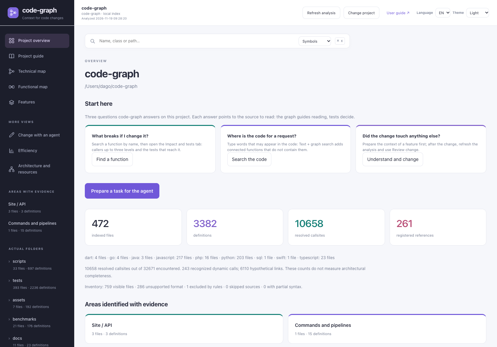
</picture>

## Perché code-graph

Gli agenti di programmazione spendono gran parte dello sforzo a *trovare* il codice giusto: cercano con grep, aprono i file uno a uno e indovinano cosa romperà una modifica. code-graph costruisce una volta il grafo statico del progetto, lo aggiorna in modo incrementale e risponde alle domande di cui un agente ha davvero bisogno:

- **Dov’è il codice di questa richiesta?** La ricerca ibrida ordina le dichiarazioni per pertinenza testuale (SQLite FTS5/BM25), poi segue chiamate e riferimenti per portare dentro le funzioni che contano ma non contengono le tue parole. → [Ricerca ibrida](#hybrid-search)
- **Cosa si rompe se lo cambio?** Chi chiama, fino alla profondità che scegli, con il punto di chiamata per ciascuno, e i test che raggiungono il simbolo.
- **Cosa deve leggere esattamente l’agente?** Finestre di sorgente delimitate con hash SHA-256, un budget di caratteri e l’elenco esplicito di ciò che è stato omesso.
- **La modifica ha fatto ciò che diceva?** Dopo la modifica firme, chiamate e segnalazioni si confrontano con una base, così un problema nuovo non si confonde con uno vecchio.

Indicizzazione e ricerca girano sul tuo computer: l’analisi non importa i tuoi moduli, non esegue il tuo codice, non chiama modelli e non invia sorgenti da nessuna parte. Ciò che il tuo agente legge poi arriva al provider di quell’agente, come in ogni sessione con un agente; vedi [PRIVACY.md](PRIVACY.md). Il grafo guida la lettura, non prova il comportamento: l’agente legge comunque il sorgente e decidono i tuoi test.

| | |
|---|---|
| **8 linguaggi + SQL** | PHP, Python, JavaScript/TypeScript, Go, Dart, Java, Swift e mappe delle risorse SQLite SQL, ciascuno con un [contratto di copertura scritto](docs/LANGUAGES.md) |
| **4 modi di usarlo** | riga di comando `cg`, dashboard locale, server MCP (15 strumenti), skill per Claude Code e Codex |
| **Scala** | Il Go SDK reale (2,2 milioni di righe, 7.035 file) si indicizza in 52 s; dopo la modifica di un file si aggiorna in 9 s ([misure](benchmarks/SCALING.md)) |
| **Nessun servizio** | Gratuito ([FSL-1.1-MIT](LICENSE.md)), nessun account, dipendenze fissate, funziona offline una volta installato |

<a id="when"></a>
## Quando conviene, e quando no

| Usalo | Lascia perdere |
|---|---|
| Centinaia di file o più, oppure codice che non hai scritto tu | Progetti piccoli: una decina di file si leggono altrettanto in fretta |
| Una modifica di cui non sei sicuro della portata: funzioni condivise, API pubbliche | Una correzione di una riga in un file che conosci già |
| Devi sapere quali test lanciare prima e dopo | Codice guidato soprattutto da reflection, route registrate come stringhe o dependency injection, dove mancano archi statici |
| Una sessione con un agente con domande ripetute *dov’è X / chi chiama Y* | Domande a cui basta un `grep` |

Il grafo aiuta a passare da una richiesta ai riferimenti nel sorgente, a vedere chi chiama il codice e a scegliere quali test eseguire. Nel benchmark sintetico, il grafo ha trovato funzioni pertinenti sfuggite alla ricerca testuale. [Risultati della ricerca ibrida](#hybrid-search)

<a id="how-it-works"></a>
## Come funziona

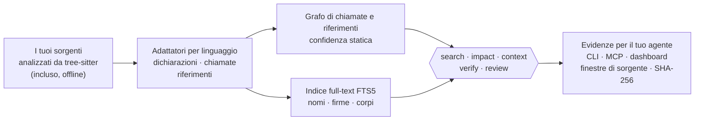

1. **Indicizza.** Ogni file è analizzato con le grammatiche tree-sitter incluse. Gli adattatori estraggono dichiarazioni, punti di chiamata e riferimenti e li risolvono con regole esplicite per ogni linguaggio. I casi irrisolti o ambigui restano registrati come tali, non vengono indovinati.
2. **Conserva.** Grafo e indice full-text stanno in un solo file SQLite, `.code-graph/graph.db`, aggiornati nella stessa transazione. La reindicizzazione rianalizza solo i file il cui hash è cambiato.
3. **Interroga.** Ricerca e letture del sorgente verificano che i file citati corrispondano ancora agli hash registrati e rifiutano le evidenze superate finché non reindicizzi. Esegui `index` dopo ogni modifica: le ricerche per nome come `find` e `show` rispondono dall’ultimo indice.
4. **Consegna.** I risultati tornano come JSON delimitato: il sorgente da leggere, perché è stato scelto e cosa è stato omesso.

<a id="hybrid-search"></a>
## Ricerca ibrida: BM25 + grafo delle chiamate, fusi con RRF

La sola ricerca testuale trova la funzione il cui *nome* contiene le tue parole. Le sfugge la funzione che questa chiama per fare il lavoro vero, e il test che la esercita, perché raramente ripetono le stesse parole. La ricerca di code-graph combina i due segnali, interamente dentro SQLite, senza embedding e senza modelli:

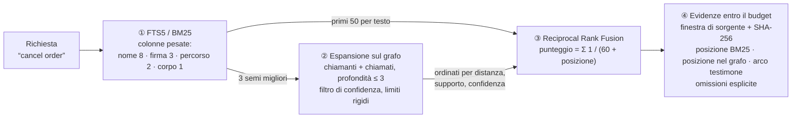

1. **Ordinamento lessicale.** FTS5 assegna a ogni dichiarazione un punteggio BM25 su nome, firma, percorso e i primi 2.000 caratteri del corpo. Gli identificatori sono spezzati ai confini `snake_case` e `camelCase`, quindi `startHTTPServer` corrisponde a *HTTP server*. Quando le parole esatte lasciano spazio, la richiesta si allarga con le radici delle parole (*cancelling* → `cancel*`) e con sinonimi comuni di programmazione (*abort* → `cancel`); questi risultati vengono dopo quelli esatti e sono marcati `expanded`.
2. **Espansione sul grafo.** Le tre migliori corrispondenze testuali diventano semi. code-graph percorre chiamate e riferimenti risolti in entrambe le direzioni (profondità predefinita 2), entro limiti fissi di 500 nodi e 1.000 archi per richiesta, e dichiara quando un limite viene raggiunto.
3. **Fusione.** La [Reciprocal Rank Fusion](https://cormack.uwaterloo.ca/cormacksigir09-rrf.pdf) unisce le due classifiche usando solo le posizioni, così un punteggio BM25 e una distanza nel grafo non vanno mai messi sulla stessa scala. Ogni simbolo conta una volta per canale; i pareggi si risolvono per percorso e riga, quindi i risultati sono deterministici.
4. **Evidenze, non solo nomi.** Ogni risultato dice *perché* è lì: la posizione testuale e il punteggio BM25, oppure l’arco di chiamata esatto (file, riga, direzione, confidenza) che lo collega a un seme. Le finestre di sorgente portano gli hash e l’intera risposta rispetta il tuo budget di caratteri.

**Un esempio concreto.** In un piccolo progetto di checkout, la richiesta `cancel order` restituisce quattro risultati (output reale di `cg search`, abbreviato):

| Risultato | Perché è stato restituito |
|---|---|
| `checkout.py: void_purchase` | corrispondenza testuale: la sua docstring dice *Cancel order* (posizione BM25 2) |
| `preview.py: obsolete_cancel_order` | corrispondenza sul nome (posizione BM25 1): un’esca che non fa nulla |
| `ledger.py: record_adjustment` | **grafo:** chiamata da `void_purchase` in `checkout.py:4`, confidenza alta |
| `tests/test_checkout.py: test_reversal` | **grafo:** chiama `void_purchase` alla riga 2, confidenza alta |

Né `record_adjustment` né `test_reversal` contengono le parole *cancel* od *order*: la sola ricerca testuale non può trovarle, eppure sono proprio ciò che un agente deve leggere ed eseguire prima di cambiare il flusso di annullamento.

**Misurato sul banco di prova della ricerca.** Sette richieste sintetiche fra Python, TypeScript e PHP, ciascuna con simboli pertinenti dichiarati ([casi](benchmarks/search-retrieval.json), [risultati](benchmarks/search-retrieval-results.json)):

<picture>
  <source media="(prefers-color-scheme: dark)" srcset="docs/images/retrieval-dark.svg">
  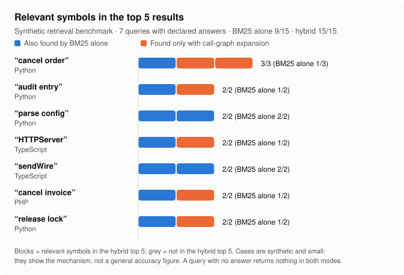
</picture>

| Modalità | Simboli pertinenti fra i primi 5 | Reciprocal rank medio | Tempo mediano¹ |
|---|---:|---:|---:|
| Solo testo (`--mode lexical`) | 9 su 15 (recall@5 media 0,62) | 0,93 | 28 ms |
| Ibrida testo + grafo RRF (predefinita) | **15 su 15 (recall@5 media 1,00)** | **1,00** | 28 ms |

¹ Mediana per richiesta su un portatile, apertura dell’indice inclusa. I casi sono piccoli e costruiti a mano per esercitare il meccanismo: non sono una misura generale di accuratezza. Sui repository reali l’espansione vale quanto gli archi risolti per ciascun linguaggio ([copertura](#languages)). Rigenera le cifre con `python3 -I benchmarks/search_retrieval.py --output …` e `python3 -I tools/readme_charts.py`.

```bash
cg --root . search "cancel order"                   # ibrida, evidenze JSON (predefinita)
cg --root . search "cancel order" --mode lexical    # solo BM25, per confronto
```

Lo stesso motore è disponibile come strumento MCP `cg_search` e nella barra di ricerca della dashboard (**Testo + grafo**). Contratto completo: [docs/SEARCH.md](docs/SEARCH.md).

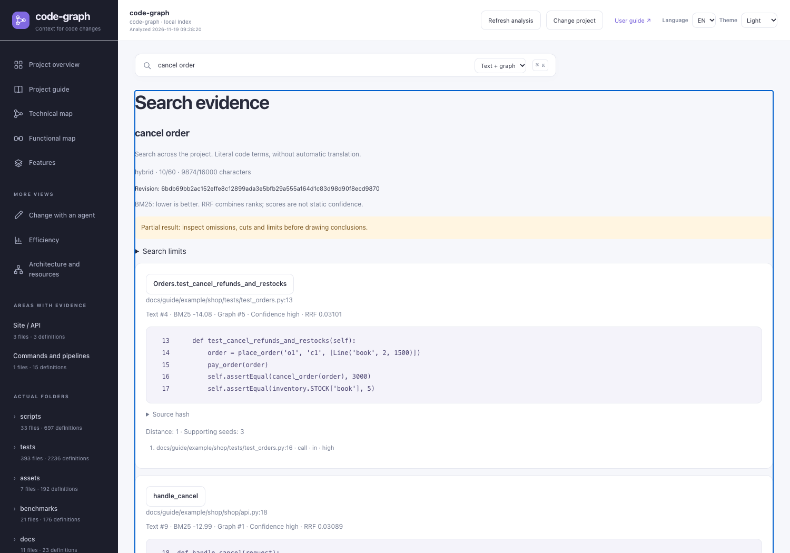

<a id="benchmarks"></a>
## Benchmark

Ogni cifra qui sotto viene da una ricevuta salvata in [`benchmarks/`](benchmarks/) e i grafici sono rigenerati da quei file con [`tools/readme_charts.py`](tools/readme_charts.py). Fallimenti e risultati negativi sono pubblicati insieme al resto.

**L’indicizzazione regge SDK reali, e restare aggiornati costa poco.** Dopo il primo indice code-graph rianalizza solo i file il cui contenuto è cambiato: sul Go SDK da 2,2 milioni di righe la modifica di un file si reindicizza in 9 s e un progetto invariato si ricontrolla in 3 s. Il Go SDK superava il limite di 600 secondi; indicizzare per package i candidati degli import l’ha portato a 52 s, con fatti identici sul sottoinsieme di confronto ([dettagli](benchmarks/SCALING.md#go-sdk-follow-up-13-november-2026)).

<picture>
  <source media="(prefers-color-scheme: dark)" srcset="docs/images/scale-dark.svg">
  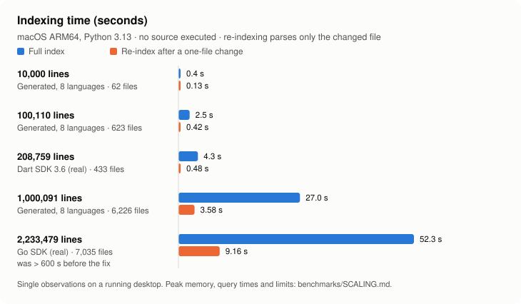
</picture>

| Progetto | Righe | File | Indice completo | Nessuna modifica | Un file modificato | Picco di memoria | Richiesta, testo / ibrida |
|---|---:|---:|---:|---:|---:|---:|---:|
| Generato, 8 linguaggi | 10.000 | 62 | 0,36 s | 0,11 s | 0,13 s | 60 MiB | 31 / 31 ms |
| Generato, 8 linguaggi | 100.110 | 623 | 2,49 s | 0,21 s | 0,42 s | 118 MiB | 50 / 51 ms |
| Dart SDK 3.6 | 208.759 | 433 | 4,33 s | 0,19 s | 0,48 s | 143 MiB | 70 / 77 ms |
| Generato, 8 linguaggi | 1.000.091 | 6.226 | 26,99 s | 1,24 s | 3,58 s | 731 MiB | 209 / 234 ms |
| Go SDK go1.27.4 | 2.233.479 | 7.035 | 52,31 s | 3,15 s | 9,16 s | 1.038 MiB | 814 / 1.037 ms |

Osservazioni singole su macOS ARM64 con Python 3.13 su un desktop in uso; le richieste sono mediane di tre campioni a cache calda di una sola richiesta. Il Dart SDK ha 29 file e il Go SDK 65 che il parser non legge del tutto; code-graph li segna come parziali e su di loro si astiene ([Dart](docs/DART.md#sdk-362-partial-file-diagnosis), [Go](docs/GO.md#sdk-grammar-investigation-13-november-2026)).

**Il grafo trova il codice che la ricerca testuale perde.** Sul banco di prova della ricerca, la ricerca ibrida mette fra i primi cinque tutti e 15 i simboli pertinenti contro 9 su 15 del solo testo, con lo stesso tempo di risposta ([grafico e avvertenze](#hybrid-search)). Su dieci richieste parafrasate con parole diverse da quelle del codice (*cancelling orders*, *free the mutex*) ora trova 22 simboli pertinenti su 22, contro 11 su 22 prima dell’aggiunta di radici e sinonimi ([casi](benchmarks/search-paraphrase.json): casi di sviluppo scritti da chi ha implementato la funzione, non un test indipendente). I casi sono piccoli e sintetici: mostrano il meccanismo, non una misura generale di accuratezza.

La versione migliorata di `locate` è stata congelata e misurata una sola volta su 45 bug storici di Django, typescript-eslint e Prometheus, scelti con una regola fissata prima di ogni esecuzione: un file della correzione storica è il primo candidato in 23 casi su 44 (main prima della modifica: 10) e fra i primi cinque in 30 (main: 17); la funzione cambiata è fra le prime cinque in 16 su 41 (main: 7). Allo stesso budget di 4.000 caratteri è 28 su 44: il guadagno viene soprattutto dall'ordinamento, non dalla risposta più lunga. Una correzione fatta dopo il congelamento costava 7 primi posti sugli stessi casi; la release 1.9.0 ripristina l'ordine valutato e lì ottiene 23 su 44, 30 su 44 e 18 su 41, con una nuova esecuzione fatta dopo aver visto i risultati e quindi non alla cieca. Misura solo la localizzazione, non gli agenti. [benchmarks/locate-bench/RESULTS.md](benchmarks/locate-bench/RESULTS.md#after-the-freeze-the-released-engine).

Gli [studi sui coding agent](benchmarks/LIVE_RESULTS.md) riportano esiti, token, costi e chiamate fallite, con il dettaglio per compito.

<a id="dashboard"></a>
## Dashboard

```bash
"$CG" explore                                          # apre il browser
"$CG" explore --workspace /percorso/progetti --no-open # stampa invece l’indirizzo
```

Un’applicazione web locale su `127.0.0.1` con porta casuale e token di sessione; esplorazione e ricerca non avviano mai un modello. Italiano o inglese, tema chiaro, scuro o di sistema. Premi **⌘K / Ctrl+K** per cercare.

**Vicinato del simbolo, impatto e test.** Fai clic su una funzione per vedere chiamanti e chiamati come grafo, il sorgente con i riferimenti registrati, ogni punto di chiamata in entrambe le direzioni e i test raggiunti attraverso le catene di chiamanti (elencati, mai eseguiti). La scheda **Contesto agente** costruisce un pacchetto per quel simbolo entro un budget di caratteri.

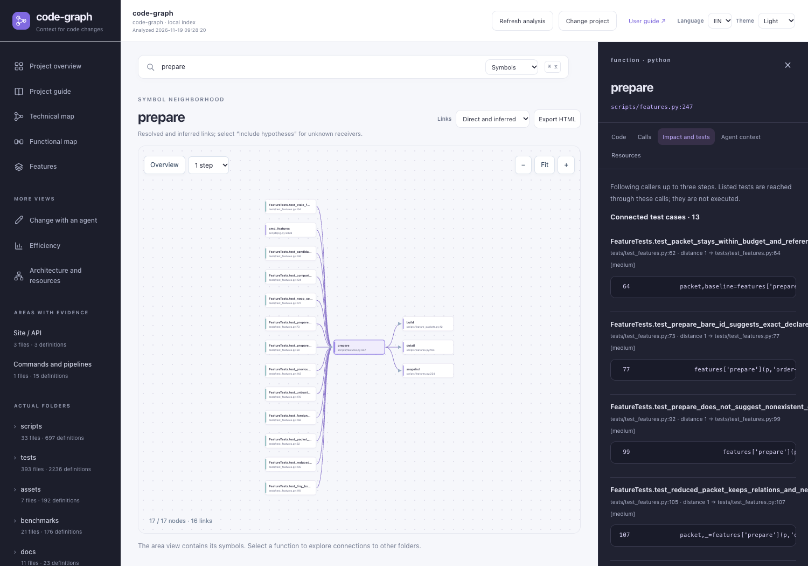

<details>
<summary><strong>Altre viste: guida al progetto, architettura e risorse, efficienza</strong></summary>

**Guida al progetto.** Da dove iniziare in questo progetto, i sei passi che segue un agente e un incarico pronto da incollare per una modifica, una domanda d’impatto, un errore, una spiegazione o un controllo finale.

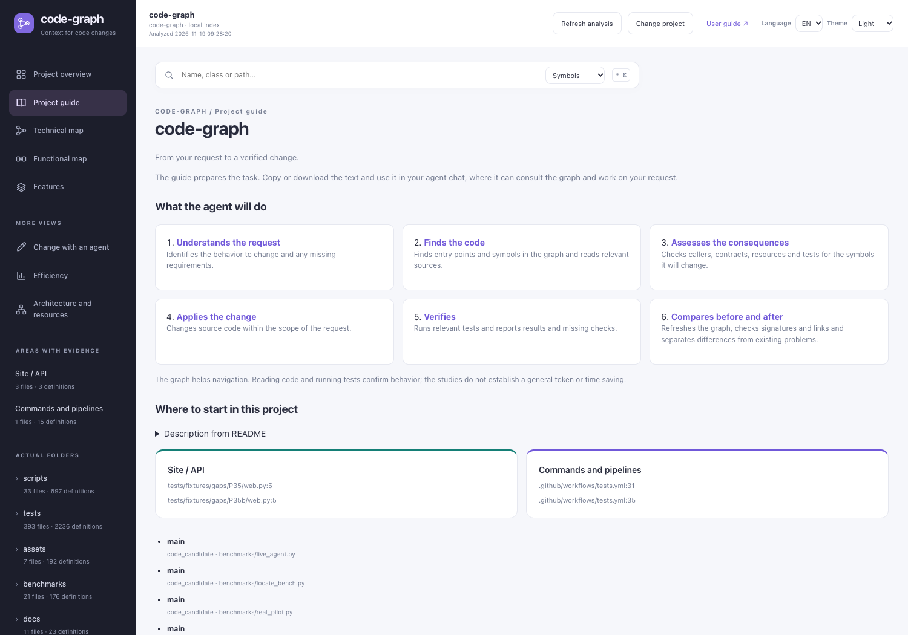

**Architettura e risorse.** Letture e scritture di file, connessioni a database e avvii di processi trovati nel sorgente, tenuti separati dalle chiamate: un percorso scritto nel codice non prova un collegamento fra due processi. SQLite SQL ha una sezione propria con dichiarazioni, letture e scritture esplicite, candidati delimitati nello stesso script e finestre di sorgente con hash. L’SQL non viene mai eseguito.

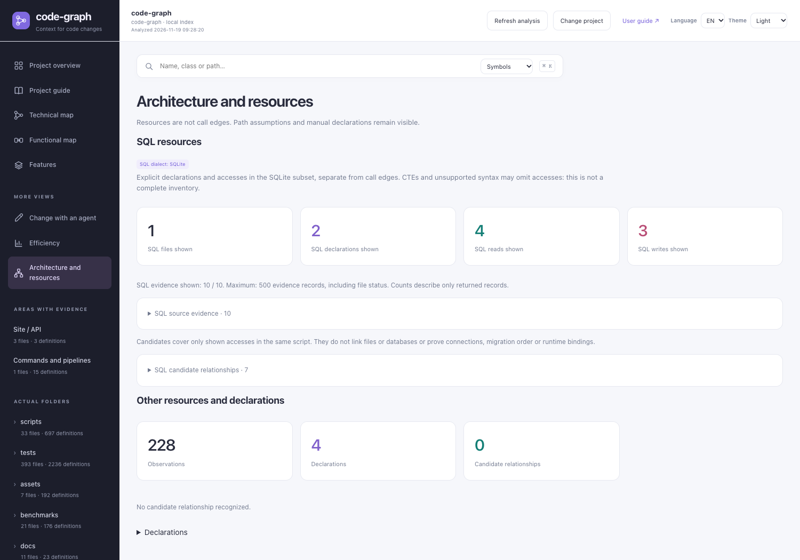

**Funzionalità → Capisci e modifica.** Parti da una scheda di funzionalità dichiarata o da un punto d’ingresso candidato; segui flusso, contratti e test riconosciuti; costruisci un pacchetto di contesto per l’agente, poi confronta firme, codice e punti di chiamata dopo la modifica.

**Efficienza.** Misura ogni lettura della dashboard: dimensione, latenza e scheda sorgente rispetto alla lettura di tutte le sezioni. I token sono stimati come caratteri Unicode / 4 e i risparmi negativi restano visibili.

Se un sorgente consultato, una configurazione o l’indice cambiano, la dashboard chiede di aggiornare l’analisi prima di mescolare coordinate vecchie e codice nuovo.

</details>

<a id="two-maps"></a>
## Due mappe, un percorso fino al codice

La **Mappa tecnica** conserva funzioni, file e chiamate statiche. La **Mappa funzionale** parte da un
nome come **Pagamento** o **Ordini**, poi apre il codice collegato, l’impatto e i test proposti. Nomi e
appartenenza sono dichiarazioni del progetto; le frecce richiedono evidenze di chiamate statiche dirette.
I candidati tecnici restano separati quando lo scopo non è dichiarato.

La stessa panoramica è disponibile al motore e agli agenti: `cg flows "Pagamento" --json` o MCP
`cg_flows`, poi `cg_prepare` sull’ID dichiarato selezionato. Evita di espandere tutte le funzionalità
solo per sceglierne una; non è una promessa misurata di risparmio di token LLM. La [guida alle due mappe](docs/guide/guides/two-maps.md)
spiega dichiarazioni, limiti ed esempi. Apri **Guida all’uso** nell’intestazione della dashboard per orientarti con schede visive e accedere subito alle viste.

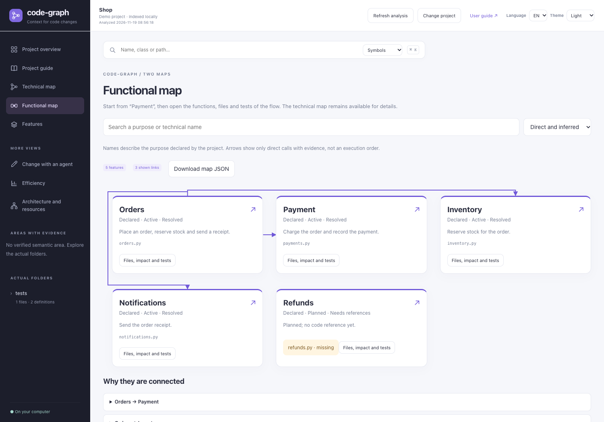

<a id="change-flow"></a>
## Modifica con un agente

Affida una modifica a Codex o Claude e seguila fino all’integrazione. Un modello scrive, l’altro rilegge, e i due passi decisivi restano tuoi:

**Analizza → Capisci → Piano (✅ approvi tu) → Modifica → Verifica → Revisione e integrazione (✅ decidi tu)**

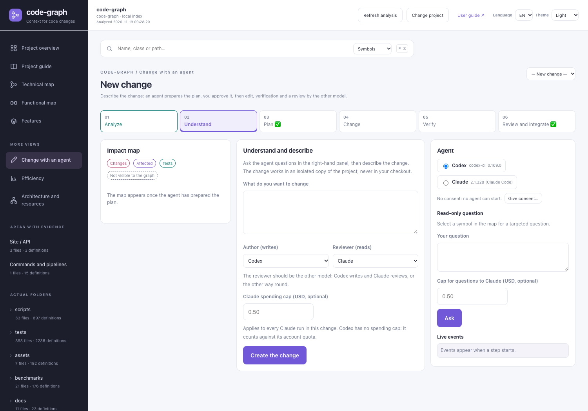

1. **Capisci.** Fai domande in sola lettura, anche su un simbolo scelto sulla mappa. Descrivi la modifica e scegli autore e revisore (di norma l’altro modello).
2. **Piano.** L’autore propone file, parti coinvolte, test, rischi e domande aperte. code-graph controlla ogni simbolo nell’indice, aggiunge l’impatto calcolato dal grafo ed elenca ciò che *non è visibile al grafo*. Scegli perimetro e comando di test, poi approvi.
3. **Modifica.** code-graph esegue prima i test approvati; l’autore modifica un worktree Git isolato, mai il tuo checkout.
4. **Verifica.** code-graph reindicizza la copia e riesegue i test. Nuovi fallimenti, errori, tempi scaduti o file fuori perimetro bloccano la modifica.
5. **Revisione e integrazione.** L’altro modello risponde *accetta*, *chiedi modifiche* o *rifiuta*, con i rilievi. Puoi rimandarla all’autore (fino a tre giri), scartarla o integrarla.

<details>
<summary><strong>Confini di sicurezza, integrazione e comandi da terminale</strong></summary>

- **Consenso.** Nessun agente parte senza il tuo consenso per la sessione, ricontrollato subito prima di ogni avvio. Da riga di comando `cg change plan`, `edit` e `review` chiedono conferma (o `--yes`) e senza terminale rifiutano.
- **Passi in sola lettura.** Domande, piano e revisione non possono scrivere: Codex gira nel sandbox `read-only`; Claude in modalità plan con solo `Read`, `Grep`, `Glob` e gli strumenti MCP di code-graph.
- **Scrittura solo nella copia isolata** `<progetto>/.code-graph/worktrees/<id>`, sul branch `cg/change-<id>`. Codex: `workspace-write`, nessuna shell. Claude: `acceptEdits`, nessun `Bash`.
- **Nessuna configurazione del progetto.** Claude non carica hook né impostazioni del progetto analizzato e riceve solo il server MCP di code-graph. Codex parte con `--ignore-user-config --ignore-rules`, quindi il tuo `config.toml` (provider, profilo, modello predefinito) non viene usato.
- **Solo code-graph esegue i test**, con il comando approvato, senza shell, entro 600 secondi. code-graph non esegue mai `git push`.
- **Costo.** Ogni esecuzione ha un limite di tempo e usa l’account del client installato. Per Claude puoi fissare un tetto di spesa in USD per modifica (`--budget-usd`) e per le domande; Codex non ha un’opzione equivalente.
- **Integrazione.** Lascia la modifica sul suo branch (predefinito) oppure uniscila a un checkout pulito con `git merge --no-ff`, senza hook Git né firma; in caso di conflitto l’unione viene annullata. L’integrazione richiede un verdetto diverso da *rifiuta* e nessun blocco di verifica, salvo una motivazione che resta nello storico. **Scarta** rimuove copia e branch; l’archivio in `.code-graph/changes/<id>/` resta.
- **L’output dei test** resta in quell’archivio: un test che stampa un segreto ve lo lascia.

```bash
"$CG" --root /percorso/progetto change new --intent "Rinomina work in compute" --author codex --reviewer claude
"$CG" --root /percorso/progetto change plan <id> --yes
"$CG" --root /percorso/progetto change approve <id> --test-argv '["python3","-m","unittest"]'
"$CG" --root /percorso/progetto change edit <id>        # --feedback "…" per un nuovo giro
"$CG" --root /percorso/progetto change verify <id>
"$CG" --root /percorso/progetto change review <id>
"$CG" --root /percorso/progetto change integrate <id>   # --merge, --force-reason "…"
```

Ogni comando attende il suo passo e stampa JSON; sono disponibili anche `list`, `show`, `discard` e `cancel`.

</details>

<a id="cli"></a>
## Riga di comando

### Primo giro da terminale

Dalla cartella in cui hai installato code-graph, puoi indicizzare un progetto e vedere un esempio di cosa chiedere:

```bash
scripts/cg --root /percorso/progetto start
```

Sul repository di code-graph stesso stampa (percorsi abbreviati, testo in italiano con `LANG=it_*` o `--lang it`):

```text
472 file sorgente: troppi da leggere uno a uno. È il caso per cui code-graph è pensato:
trovare il codice di una richiesta, l’impatto di una modifica e i test da lanciare.

1. Cosa si rompe se lo cambio, e quali test devo lanciare?
   prepare è chiamata da 13 punti; attraverso quelle chiamate la raggiungono 13 test.
   $ cg --root . impact scripts/features.py:prepare --depth 3
   $ cg --root . verify scripts/features.py:prepare --plan
2. Dov’è il codice di una richiesta?
   $ cg --root . search prepare
3. La mia modifica ha toccato qualcosa che non volevo?
   $ cg --root . review --base HEAD
```

Le stesse tre domande aprono la dashboard (`cg explore`), ciascuna con un pulsante che porta alla vista giusta.

| Vuoi sapere | Comando | Cosa ottieni |
|---|---|---|
| Dove intervenire per una richiesta, in una sola risposta | `locate "testo della richiesta"` | I punti probabili da cambiare con codice, chiamanti e test, più quanta lettura ti ha risparmiato (nessun modello; aggiorna prima l’indice) |
| Cosa si rompe se cambio questo, e quali test lanciare | `impact <simbolo>` · `verify <simbolo> --plan` | Chiamanti fino alla profondità che scegli, ciascuno con il punto di chiamata, e i test raggiunti attraverso di loro (elencati, mai eseguiti) |
| Dov’è il codice di una richiesta, in un progetto che non conosci | `search "parole"` | Le dichiarazioni pertinenti più le funzioni che chiamano o da cui sono chiamate, con finestre di sorgente e hash |
| Se una modifica ha toccato qualcosa di non voluto | `review --base HEAD` | Firme, chiamate e segnalazioni confrontate con l’ultimo commit, più un piano di test |

Ogni comando prende `--root <progetto>` **prima** del nome del comando. Esegui `index` all’inizio e dopo ogni modifica: rianalizza solo i file cambiati.

```bash
"$CG" --root /percorso/progetto index
"$CG" --root /percorso/progetto search "cancel order" --max-chars 9000
"$CG" --root /percorso/progetto impact 'OrderService.cancel' --depth 3
"$CG" --root /percorso/progetto context 'OrderService.cancel' --profile change --max-chars 4000
"$CG" --root /percorso/progetto verify 'OrderService.cancel' --plan --json
"$CG" --root /percorso/progetto review --base HEAD --json
```

<details>
<summary><strong>Tutti i comandi</strong></summary>

| Comando | Cosa ottieni |
|---|---|
| `start [--lang en\|it] [--json]` | Indicizza il progetto e mostra tre domande da porgli, con un esempio reale e i comandi pronti. |
| `index [--full]` | Crea o aggiorna `.code-graph/graph.db`; segnala esclusioni e analisi parziali. |
| `locate TESTO [--limit 5] [--max-chars 5000]` | Dal testo di una richiesta ai punti da cambiare, con codice, chiamanti e test, e la lettura risparmiata. Nessun modello. |
| `search QUERY [--mode hybrid\|lexical] [--max-chars 9000]` | Evidenze JSON ordinate con FTS5/BM25 e RRF sul grafo. |
| `map [--depth 2] [--limit 25]` | Dimensioni dei moduli, dipendenze, punti caldi e probabili punti d’ingresso. |
| `find <pattern> [--kind class\|method\|function]` | Simboli per nome o pattern `*`. |
| `show <sym>` | Firma, membri, basi e numero di vicini. |
| `callers <sym>` / `callees <sym>` | Vicini con confidenza e un punto di chiamata ciascuno; `callees` elenca anche chiamate esterne e dinamiche. |
| `impact <sym> [--depth 3] [--min-conf medium]` | Chiamanti transitivi e test trovati; callback e registrazioni tramite decoratore compaiono come riferimenti. `impact <file> --file` lavora su un file intero. |
| `path <A> <B>` | Il percorso di chiamata più breve trovato fra due simboli. |
| `context <sym> [--max-chars 4000] [--profile understand\|change\|debug\|review]` | Contesto per un agente entro un budget di caratteri, con omissioni dichiarate. |
| `source <file> [--line N] [--max-chars 1200]` | Una finestra di sorgente delimitata con colonne Unicode e hash. |
| `features [--query parole]` / `prepare [scheda] …` | Schede di funzionalità, punti d’ingresso e un pacchetto di contesto per modificarle. |
| `verify <sym> --plan` | Piano test leggibile con argv per test e aggregato; `--json` conserva le evidenze strutturate. Una proposta: nulla viene eseguito. |
| `review [--base REF] [--staged]` | Riepilogo leggibile di baseline, rilievi e test; `--json` conserva l’analisi strutturata del diff. |
| `check` / `dead [--all]` | Candidati: arità, metodi mancanti, duplicati, cicli; simboli senza chiamanti noti. |
| `architecture` / `stats` | Osservazioni sulle risorse separate dalle chiamate; copertura dell’indice. |
| `export [--symbol <sym>] [--depth 2]` | Un grafo HTML offline autonomo (nessun server, rete o CDN). |
| `explore` / `mcp` | La dashboard; il server MCP su stdio. |
| `change …` | Il flusso di modifica da terminale. |
| `selftest` | 25 controlli sulle fixture: `TRUST` o `DISTRUST`. |

`<sym>` può essere `nome`, `Classe.metodo`, `Classe::metodo`, `percorso/file.php:nome` o `percorso/file.php:123`; ripeti un nome ambiguo con il percorso o la classe. La maggior parte dei comandi accetta `--json`; la sintassi completa è in [SKILL.md](SKILL.md).

</details>

<a id="mcp"></a>
## Server MCP

```bash
"$CG" --root /percorso/progetto mcp
```

Un server MCP su stdio con quindici strumenti: `cg_locate`, `cg_search`, `cg_flows`, `cg_find`, `cg_show`, `cg_callers`, `cg_callees`, `cg_impact`, `cg_verify_plan`, `cg_prepare`, `cg_source`, `cg_read`, `cg_review`, `cg_check` e `cg_index`. Nessuno strumento cambia i tuoi sorgenti o esegue il codice analizzato; `cg_index` aggiorna solo la cache `.code-graph`. Le risposte si fermano a 40.000 caratteri con un marcatore esplicito. Il flusso di modifica passa questo server a Codex e Claude automaticamente.

<details>
<summary><strong>Prompt d’esempio</strong></summary>

```text
Se cambio OrderService.cancel, quali parti possono essere coinvolte? Elenca i test che lo raggiungono.
```

```text
Prepara il contesto per correggere questo errore: [errore]. Mostrami i riferimenti nel codice.
```

```text
Ricostruisci il flusso da CheckoutController.submit a OrderRepository.save ed elenca i passi che il grafo non ha risolto.
```

```text
Confronta prima e dopo questa modifica: cosa è cambiato e quali controlli servono ancora?
```

```text
Usa il flusso di modifica di code-graph su questo progetto: Codex scrive, Claude rilegge. Mostrami piano e comando di test prima di qualsiasi approvazione: [descrizione].
```

</details>

<a id="languages"></a>
## Linguaggi

Ogni linguaggio ha un contratto scritto: cosa viene risolto e dove l’analisi si astiene di proposito invece di indovinare. Non servono compilatori, SDK o language server.

| Linguaggio | Cosa viene risolto | Contratto |
|---|---|---|
| Python | Import e riesportazioni, ricevitori tipizzati, callback e decoratori, moduli caricati con `importlib`/`runpy`, route FastAPI/Flask | [LANGUAGES](docs/LANGUAGES.md) |
| JavaScript / TypeScript | Moduli ES e CommonJS, barrel, path di `tsconfig`, pacchetti workspace, componenti JSX | [LANGUAGES](docs/LANGUAGES.md) |
| PHP | Namespace, import di funzioni e classi, callback, hook WordPress | [LANGUAGES](docs/LANGUAGES.md) |
| Go | Chiamate fra package e import, ricevitori concreti espliciti; interfacce e varianti di build si astengono | [GO](docs/GO.md) |
| Dart | Librerie, import relativi e `package:` locali, metodi statici; il dispatch d’istanza si astiene | [DART](docs/DART.md) |
| Java | Sottoinsieme dichiarato static/private/final; overload e dispatch virtuale si astengono | [JAVA](docs/JAVA.md) |
| Swift | Sottoinsieme private/static nel file; overload e import si astengono | [SWIFT](docs/SWIFT.md) |
| SQLite SQL | Tabelle, viste e query con osservazioni di lettura/scrittura, separate dalle chiamate | [SQL](docs/SQL.md) |

<a id="limits"></a>
## Limiti

- **Una guida, non una prova.** Le confidenze `high`, `medium` e `low` descrivono come è stata risolta una chiamata, non che venga eseguita. Dispatch dinamico, reflection, dependency injection e route registrate come stringhe possono lasciare archi mancanti o errati.
- **Lessicale, non semantica.** La ricerca usa le parole che scrivi, le loro radici e un piccolo elenco di sinonimi comuni di programmazione; non traduce una domanda e non usa embedding. Chiedi all’agente di riformulare la richiesta in termini di codice: la [guida alla ricerca per agenti](docs/AGENT_SEARCH.md) lo fa.
- **Solo candidati.** `check` e `dead` producono candidati da confermare; `VERIFIED_DEAD` non autorizza una cancellazione.
- **Cosa viene indicizzato.** Dipendenze incluse, cartelle di build, file ignorati da Git, link simbolici, file oltre 1 MB e file minificati sono esclusi; aggiungi pattern in `.cgignore`.
- **Dati locali.** `.code-graph/graph.db` contiene metadati ed estratti di sorgente. Si esclude da solo da Git; non pubblicarlo. Vedi [PRIVACY.md](PRIVACY.md).
- **Misure.** I [risultati di scala](benchmarks/SCALING.md) descrivono i repository e l’hardware usati. Lo [studio con gli agenti](benchmarks/LIVE_RESULTS.md) copre 23 bug storici in tre repository, con un’esecuzione per variante.
- **Lingua dell’interfaccia.** Riga di comando, messaggi del motore e [guida](docs/guide/README.md) sono in inglese; dashboard, `cg start` e questo README sono in italiano e inglese. Le chiavi JSON sono in inglese.

```bash
scripts/cg selftest
.venv/bin/python -I tools/parallel_tests.py   # l’intera suite in processi paralleli
```

<a id="news"></a>
## Novità

**1.9.0 — locate, test da lanciare, scala di Django e localizzazione misurata**

- **`locate`.** Un solo comando da una richiesta, una issue o uno stack trace ai punti da cambiare, con sorgente, chiamanti e test, entro un budget di caratteri e con la lettura risparmiata. Richieste fino a 200.000 caratteri; su 45 bug storici un file della correzione è il primo candidato in 23 casi su 44 (main prima: 10). [Risultati](benchmarks/locate-bench/RESULTS.md).
- **Test da lanciare.** `verify` e `review` propongono comandi pronti per pytest, unittest, Go, Jest/Vitest e PHPUnit (con il Python del progetto) e stampano un riepilogo breve e leggibile; `review --summary --json` è una risposta compatta per gli agenti.
- **Scala di Django.** La risoluzione degli import Python è indicizzata: Django si indicizza in 18 s invece di 98 s e `review --base` impiega 40 s invece di oltre 600 s, con fatti identici ([ricevuta](benchmarks/django-scale.json)).
- **Documentazione e lingua.** Una [guida](docs/guide/README.md) completa con esempi reali e un riferimento generato dal codice; riga di comando, messaggi del motore e SKILL.md in inglese.
- **Risultati dei benchmark.** Il benchmark di localizzazione e lo studio su 23 bug storici includono i protocolli e i risultati per ogni caso. [Benchmark](#benchmarks)
- **Correzioni dal campo.** I metodi degli enum PHP non sono più segnalati come mancanti; `cg start` non esce più in silenzio quando la funzione d'esempio ha un nome ambiguo. Licenza [FSL-1.1-MIT](LICENSE.md).

<details>
<summary><strong>Versioni precedenti</strong></summary>

- **1.8.0** — Avvio guidato (`cg start` e il riquadro Inizia da qui della dashboard), Go alla scala di un SDK (52 s per 2,2 milioni di righe), un pilota su repository reale con SymPy e i benchmark nel README.
- **1.7.0** — Ricerca ibrida locale (SQLite FTS5/BM25 con RRF sul grafo), adattatori Go, Dart, Java e Swift, mappe delle risorse SQLite SQL e indicazioni di ricerca nel flusso di modifica.
- **1.6.5** — Catalogo API locale (`cg catalog`), decoratori e ricevitori Python più precisi, più route FastAPI/Flask, correzioni a moduli e riferimenti JS/TS, `relation` nell’impatto JSON.
- **1.6.4** — Più chiamanti trovati tramite riesportazioni Python e ricevitori tipizzati, callback e comandi registrati come riferimenti, barrel e alias di percorso JS/TS, import di funzioni PHP; meno falsi candidati di codice morto.
- **1.6.3** — Chiamanti dei moduli caricati con `importlib` o `runpy`.
- **1.6.2** — Flusso di modifica più stabile con percorsi di piano non validi, link creati dai test, output MCP e segnali su macOS.
- **1.6.1** — Conferma da riga di comando prima di avviare un agente, tetto di spesa per Claude, dashboard più stabile ed esecuzione parallela dei test.
- **1.6.0** — Modifica con un agente: sei passi, worktree isolato, test prima e dopo, revisione dell’altro modello; il server MCP.
- **1.5** — Finestre di sorgente delimitate; Capisci e modifica con schede di funzionalità e pacchetti di contesto.
- **1.4** — Contesto entro un budget di caratteri, revisione dei diff con piano di test, pannello Efficienza, italiano/inglese e temi chiaro/scuro.

</details>

Storia completa: [CHANGELOG.md](CHANGELOG.md).

<a id="community"></a>
## Sponsor, sostenitori e contributori

code-graph è libero da usare e cresce con chi lo usa, segnala cosa il grafo non vede e ne parla.

<a id="support"></a>
### Sostieni lo sviluppo

Se code-graph ti è utile, [lascia una stella su GitHub](https://github.com/dagoSte/code-graph) ⭐ e sostieni il mio lavoro con un contributo su Ko-fi.

[](https://ko-fi.com/J3K52ADG60)

### Sostenitori e contributori

Chi contribuisce al codice compare nella [pagina dei contributori](https://github.com/dagoSte/code-graph/graphs/contributors) di GitHub. Sponsorizzazioni di persone e organizzazioni sono benvenute: contribuisci su [Ko-fi](https://ko-fi.com/J3K52ADG60) o [apri una issue](https://github.com/dagoSte/code-graph/issues) per parlarne.

### Partecipa

- **Segnala un problema o proponi un’idea** nelle [issue](https://github.com/dagoSte/code-graph/issues). Per un problema di sicurezza segui [SECURITY.md](SECURITY.md).
- **Contribuisci** con una [pull request](https://github.com/dagoSte/code-graph/pulls); esegui prima `selftest` e la suite di test. I contributi sono accettati con la [licenza](LICENSE.md) del progetto.
- **Raccontaci come va** sui tuoi progetti: cosa ha aiutato l’agente, cosa mancava, cosa il grafo non vedeva.
- **Lascia una stella** ⭐ al repository e condividilo se aiuta il tuo team.

---

[FSL-1.1-MIT](LICENSE.md): uso, modifica e condivisione liberi per ogni scopo tranne un prodotto o servizio concorrente; ogni versione diventa MIT due anni dopo l’uscita · Sviluppato da Stefano D’Agostino · [GitHub](https://github.com/dagoSte/code-graph)
