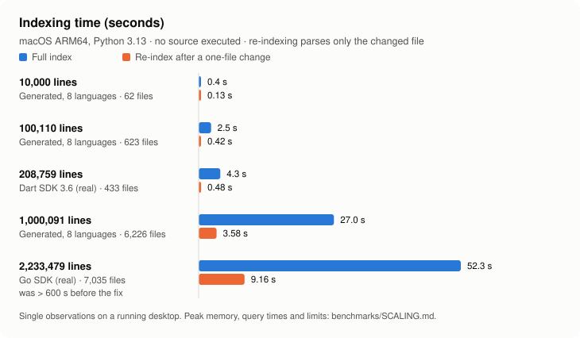
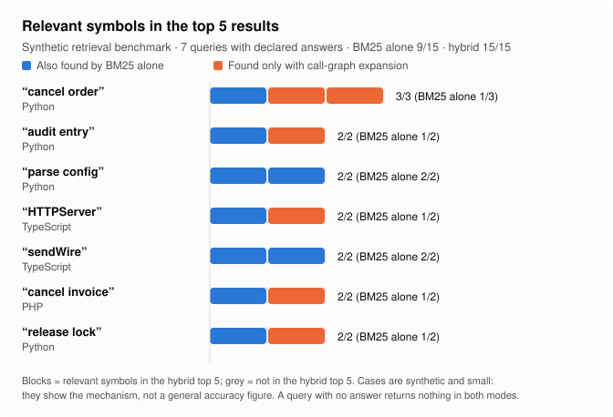

# Benchmarks

Every figure here comes from a receipt committed in [`benchmarks/`](../../benchmarks/), and failures and
negative results are published with the rest. They describe these runs, not a general guarantee.

## Indexing

The index scales to real SDKs, and keeping it current is cheap: after the first index, only files whose
content changed are parsed again.

| Project | Lines | Files | Full index | Unchanged | One-file change | Peak memory | Query, text / hybrid |
|---|---:|---:|---:|---:|---:|---:|---:|
| Generated, 8 languages | 10,000 | 62 | 0.36 s | 0.11 s | 0.13 s | 60 MiB | 31 / 31 ms |
| Generated, 8 languages | 100,110 | 623 | 2.49 s | 0.21 s | 0.42 s | 118 MiB | 50 / 51 ms |
| Dart SDK 3.6 | 208,759 | 433 | 4.33 s | 0.19 s | 0.48 s | 143 MiB | 70 / 77 ms |
| Generated, 8 languages | 1,000,091 | 6,226 | 26.99 s | 1.24 s | 3.58 s | 731 MiB | 209 / 234 ms |
| Go SDK go1.27.4 | 2,233,479 | 7,035 | 52.31 s | 3.15 s | 9.16 s | 1,038 MiB | 814 / 1,037 ms |

Single observations on macOS ARM64 with Python 3.13 on a running desktop; queries are medians of three
warm samples of one query. The Dart SDK has 29 and the Go SDK 65 files the parser cannot fully read;
code-graph marks them partial, keeps what the parser could read and reports the rest as missing. Details: [SCALING.md](../../benchmarks/SCALING.md).

## Retrieval

On the retrieval benchmark, hybrid search puts all 15 relevant symbols in the top five, against 9 of 15
for text matching alone, at the same query time ([cases](../../benchmarks/search-retrieval.json),
[results](../../benchmarks/search-retrieval-results.json)).

On ten paraphrased queries whose words differ from the code (*cancelling orders*, *free the mutex*), it
finds 22 of 22 relevant symbols, against 11 of 22 before word roots and synonyms were added
([cases](../../benchmarks/search-paraphrase.json), [results](../../benchmarks/search-paraphrase-results.json)).
These cases were written by the implementer during development; they are small and synthetic, and show
the mechanism rather than a general accuracy figure.

## With agents

Codex fixed bugs and Claude reviewed them, with and without code-graph. Both arms had literal text search
and file reading; the assisted arm also had the code-graph MCP tools.

| Study | Outcome | With code-graph vs without | What it means |
|---|---|---|---|
| **23 historical bugs**, Django, typescript-eslint and Prometheus, protocol fixed in advance | Same bugs fixed in both arms: 1 of 23 as recorded, 4 of 23 after a disclosed correction of the test-preservation check; no bug fixed by only one arm | Planning +45% Codex input tokens, editing +5%; Claude 3.68 vs 3.44 USD | No evidence of better outcomes or token savings on these tasks |
| SymPy, four historical bugs (880 source files) | Bugs fixed: 3 of 4 with code-graph, 2 of 4 without | +9% time, +15–23% Codex input tokens per phase | A single-bug difference that the larger study did not reproduce |
| 1.8, four small tasks (10–13 files each) | 8 of 8 paths reached review, all accepted | +27% time, +35% Codex input tokens | No benefit on projects this small: reading every file is cheap |
| 1.7.0, two small tasks | 2 of 4 paths reached review | — | Inconclusive: the Claude account limit stopped every review |

The 23-bug study ([results](../../benchmarks/LIVE_RESULTS.md#three-repositories-23-historical-bugs-equal-success-counts-no-aggregate-input-token-saving)) ran 138 model calls for 7.12 USD of Claude reviews, with every
path, failure and token counter published. Its test-preservation check rejected tests to which the
agent had only added cases; a correction fixed before the remaining results raised both arms from
1 to 4, and both scorings are published. The study measures independent plan, edit and review calls
on public bugs that models may have seen; it says nothing about long sessions or human use of
`impact`, `verify` and `review`.

## Localization without models

On the same 23 bugs, `locate` was run once on the original issue text, before any model call:

| Repository | Fix file among the first 3 candidates | Fixed function among the first 5 |
|---|---:|---:|
| Prometheus (Go) | 7 of 7 | 4 of 7 |
| Django (Python) | 3 of 8 | 2 of 4 with a mapped function |
| typescript-eslint | 1 of 8 | 0 of 8 |
| **All** | **11 of 23** | **6 of 19** |

Within its 4,000-character default budget, `locate` returned three or four candidates rather than five.
These are the numbers of the frozen engine of the study; changes to `locate` are measured on other bugs.

### 45 new bugs

The improved `locate` (five candidates at a 5,000-character default; kebab-case names, paths and
qualified names as code terms; source URLs reduced to their indexed path) was frozen and measured
once on 45 other historical bugs, 15 per project, selected by a rule fixed before any run and
excluding the 23 above. One case has no production change in its fix and is scored on 44.

| Endpoint | main, 4,000 | new, 4,000 | new, 5,000 |
|---|---:|---:|---:|
| Fix file first | 10 of 44 | 23 of 44 | 23 of 44 |
| Fix file among the first 5 | 17 of 44 | 28 of 44 | 30 of 44 |
| Changed function among the first 5 | 7 of 41 | 16 of 41 | 16 of 41 |

At the same budget 12 cases improve and 1 regresses. By project, fix file among the first 5 at 5,000 characters: Django 8 → 8
of 15, Prometheus 9 → 10 of 15, typescript-eslint 0 → 12 of 14. One Django case fails in every run because
its issue text exceeded the 20,000-character input limit of that engine. The cohort is not random and a historical fix need
not be the only correct one; the bench measures localization, not agents or tokens.

After the freeze, a review fix ranked files named in the request after the best text matches and lost
7 first-place hits on these cases (16 of 44). Release 1.9.0 restores the evaluated order, keeps the other
fixes and accepts requests up to 200,000 characters: on the same 45 cases it scores 23 of 44 first, 30 of
44 among the first 5 and 18 of 41 for the changed function, with no failed query. That re-run was made after
seeing the results, so it is not blind; the receipts and the per-case differences are in RESULTS.md. Every number was recounted independently by a non-author reader:
[benchmarks/locate-bench/RESULTS.md](../../benchmarks/locate-bench/RESULTS.md).
