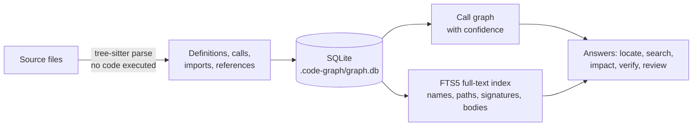
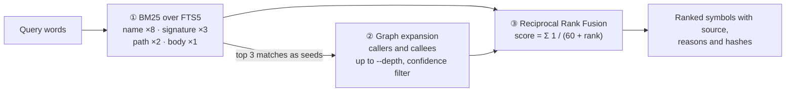

# Concepts

How code-graph builds its answers, and how far each one can be trusted.



## The index

`cg index` parses every supported file with [tree-sitter](https://tree-sitter.github.io/) and stores
definitions (functions, methods, classes), calls, imports and references in one SQLite file,
`<project>/.code-graph/graph.db`. The analysed code is never imported or executed.

- **Incremental.** Each file is recorded with a content hash. A new `index` re-parses only files whose
  hash changed and removes deleted ones; on a 2.2-million-line SDK a one-file change takes seconds
  ([Large projects](guides/large-projects.md)).
- **What is skipped.** Vendored dependencies, build folders, Git-ignored files, symlinks, files over
  1 MB and minified files. Add your own globs to `.cgignore`.
- **Partial files.** When the parser cannot read part of a file, the file is marked partial. What the
  parser could read is kept, and the facts that depend on the unreadable part are missing; every
  finding from a partial file carries `partial_syntax` among its uncertainties. `start` reports how many
  partial files there are.

`locate` and `start` refresh the index themselves. Every other command answers from the last index, and
commands that read source refuse to answer when a file changed since: run `cg index` after you change
code.

## The graph and its confidence

Every call the parser sees is resolved, when possible, to the definition it reaches. The edge records
the callsite (file and line) and **how** it was resolved:

| Confidence | Typical evidence |
|---|---|
| `high` | A direct resolution: a named import, `self`/`this`, the enclosing class, an inferred type |
| `medium` | Often a unique name in the project, or an interface with one implementation |
| `low` | Candidates with the same name, or receivers whose type is unknown |

Confidence describes the resolution, **not** that the call runs. Commands follow `medium` and above by
default; `--min-conf low` widens a search when a change is delicate. Calls into the standard library,
vendored or external code stay unresolved and are reported as such.

**What the graph does not see.** Calls decided at run time: dynamic dispatch through an interface with
many implementations, reflection, dependency injection, string-registered routes or hooks,
`getattr`-style lookups. Each language has a written contract of what is resolved and where the
analysis deliberately abstains: see [Languages](languages.md).

## Hybrid search

`cg search` answers *where is the code for this?* in three steps.



1. **Text.** SQLite FTS5 ranks definitions with BM25. A word in the name weighs eight times a word in
   the body, so `cancel_order` beats a function that mentions cancelling in a comment. Identifiers are
   split at underscores and camel case, so `cancelOrder`, `cancel_order` and `CancelOrder` all match
   *cancel order*. Bodies are indexed up to their first 2,000 characters.
2. **Graph.** The three best text matches become seeds. Their callers and callees, up to `--depth`
   steps and above the confidence threshold, join the candidates with the exact call edge that
   connected them.
3. **Fusion.** Reciprocal Rank Fusion merges the text ranking and the graph ranking: each list
   contributes `1 / (60 + rank)`. A function that ranks well in both lists rises; one found only by the
   graph (a caller whose text never mentions your words) still enters the results.

**When the exact words miss.** If a request is worded differently from the code, search widens each
word to its root (*cancelling* → `cancel*`) and to a short list of common programming synonyms
(*release* → *free*, *unlock*). Widened matches are marked `expanded` and never outrank an exact match
in the same query. There are no embeddings and no translation: it matches words, not meaning.

`--mode lexical` keeps only step 1. The [benchmarks](benchmarks.md) compare both modes.

## locate: search for a request

`cg locate` is the entry point for a request written in prose, an issue or a stack trace:

1. It keeps code-like terms (backticks, `dotted.names`, `snake_case`, `camelCase`, `kebab-case` and
   scoped names), then the most frequent plain words, without stop words and generic bug vocabulary.
   URL payloads and repository/branch prefixes are ignored; source-file links keep an indexed path
   suffix (otherwise the filename) as evidence. Directory words from paths do not enter the query.
   Kebab words receive code-name priority uniformly. English prose compounds can therefore precede
   a qualified name in the query; this is a known limitation, with no compound-specific exclusions.
2. It runs hybrid search with word roots. Explicit indexed paths, unique file names and qualified
   symbols can enter independently of the global lexical cap. Within a named file, BM25 ranks up to
   three matching declarations with search's usual weights, without falling back to the first
   declarations by line number. Filename words match every declaration's indexed path, so a match
   can be path-only and does not prove that the name or body matches. Ordinary words and ambiguous basenames do not
   promote files. At most 32 distinct code references are resolved this way.
3. Stack-trace frames (Python, JavaScript/TypeScript, Go) are matched to indexed files by path suffix
   and to functions by name before line number, because a trace often comes from another version.
   Frames lead, then qualified symbols, the two best text matches (name coverage first), file hints and the fused
   ranking. Up to two declarations per file precede additional declarations from the same file,
   with backfilling when too few matching files exist.
4. Test files are left out of the candidates. Each candidate has caller/test totals, one shown caller
   and test, and up to two source lines of 100 characters each. Hashes and explicit truncation allow
   an agent to request the rest. A named file can still be incidental context rather than the cause.

The answer stays within a character budget (`--max-chars`, default 5,000). When even one candidate does
not fit, the status is `budget_insufficient` and nothing is cut silently.

## Evidence you can check

Answers are built to be verified, not trusted:

- **Locations.** Every symbol, caller and test comes with `file:line`.
- **Hashes.** Source windows carry the SHA-256 of the file they come from. Commands that read source
  refuse to answer when a file changed after indexing, instead of mixing old lines with new code.
- **Budgets and omissions.** Each answer respects its character budget and says what it left out:
  `omitted`, `truncated`, `lines_cut`, continuation commands for the rest of a source window.
- **Limitations.** JSON answers list what the method cannot see for that question.

## Reading saved

`locate` reports how many characters you would have read in the files its candidates, callers and tests
live in, against the characters of the answer itself:

```text
reading: 1,139 characters here instead of 2,848 in 6 files (60% less to read)
```

This measures **reading**, for one question, against a simple baseline: opening those files whole. It
is not a measurement of an agent's tokens, which also depend on the prompt, the model's own reasoning
and what it decides to open afterwards. The live pilots in [Benchmarks](benchmarks.md) report agent
tokens separately, including the cases where code-graph used more.
