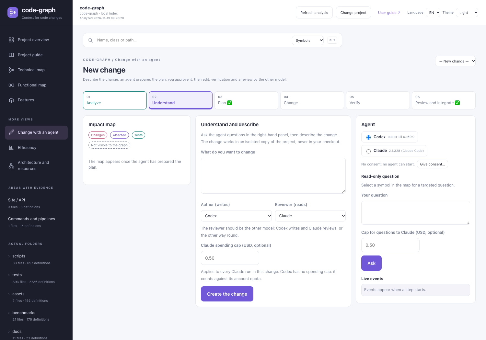

# Change with an agent

Hand a change to Codex or Claude Code and follow it to integration. One model writes, the other
reviews, and the two decisive steps stay with you:

**Understand → Plan (you approve) → Change → Verify → Review → Integrate (you decide)**



It needs `codex` and/or `claude` installed and signed in. Each run uses your own account.

## The steps

1. **New.** Describe the change and choose the author and the reviewer, normally the other model.
2. **Plan.** The author proposes files, affected definitions, tests, risks and open questions.
   code-graph checks every symbol against the index, adds the impact computed from the graph and lists
   what the graph cannot see.
3. **Approve.** You choose the scope and the exact test command. The tests run once now: that is the
   baseline.
4. **Edit.** The author edits an isolated Git worktree, never your checkout.
5. **Verify.** code-graph re-indexes the copy, runs the approved tests again and reviews the diff
   statically. New failures, errors, timeouts or files outside the approved scope block the change.
6. **Review.** The other model reads the diff and answers *accept*, *request changes* or *reject*, with
   findings. You can send it back for another edit round.
7. **Integrate or discard.** Leave the change on its branch (default) or merge it into a clean checkout;
   or discard it.

## From the command line

```bash
cg change new --intent "Refund partial payments when an order is cancelled" --author codex --reviewer claude
cg change plan <id> --yes
cg change approve <id> --test-argv '["python3", "-m", "unittest"]'
cg change edit <id> --yes                 # --feedback "…" for a new round
cg change verify <id>
cg change review <id> --yes
cg change integrate <id>                  # --merge to merge, --force-reason "…" to override a block
```

Each command waits for its step and prints JSON. `list`, `show`, `cancel` and `discard` are also
available; every option is in the [CLI reference](../reference/cli.md#change).

## Safety boundaries

- **Consent.** No agent starts without your confirmation: `plan`, `edit` and `review` ask for it, or
  take `--yes`, and refuse without a terminal.
- **Read-only steps.** Plan and review cannot write: Codex runs in its `read-only` sandbox; Claude runs in
  plan mode with only `Read`, `Grep`, `Glob` and the code-graph MCP tools.
- **Writing only in the copy** `<project>/.code-graph/worktrees/<id>`, on branch `cg/change-<id>`.
  Codex: `workspace-write`, no shell. Claude: `acceptEdits`, no `Bash`.
- **No project configuration.** Claude loads no hooks or settings from the analysed project; Codex starts
  with `--ignore-user-config --ignore-rules`.
- **Only code-graph runs tests**, with the approved command, without a shell, within 600 seconds.
  code-graph never runs `git push`.
- **Cost.** A Claude spending cap in USD can be set per change with `--budget-usd`; Codex has no such
  option.
- **Integration** needs a verdict other than *reject* and no verification blockers, unless you give a
  reason that stays in the history. On a merge conflict the merge is aborted.
- **Archive.** Each change keeps its record and test output in `.code-graph/changes/<id>/`, also after a
  discard. A test that prints a secret leaves it there.
