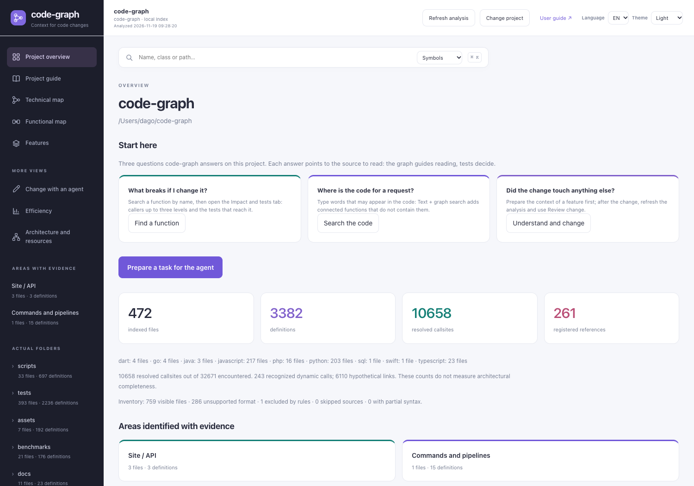
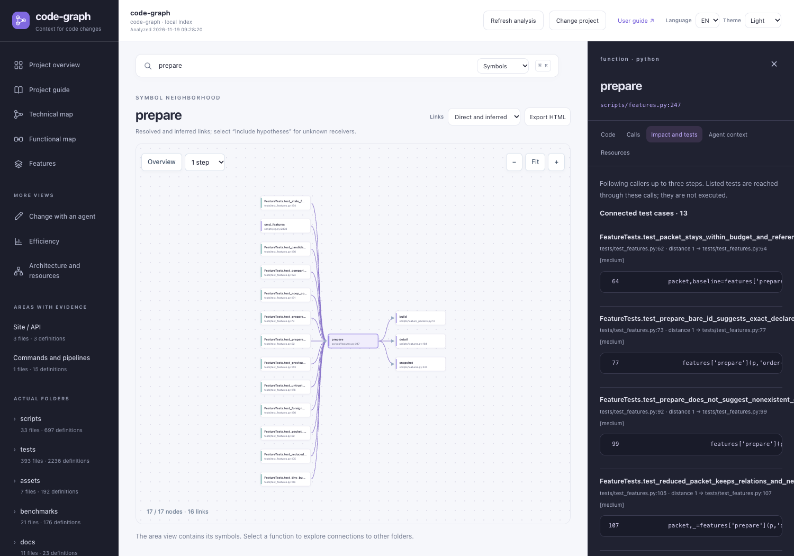

# Dashboard

`cg explore` opens a local web app with the same answers as the command line, for browsing a project
with the mouse.

```bash
cg explore                                          # opens the browser
cg explore --workspace ~/code --no-open             # prints the address instead
```

It listens on `127.0.0.1` on a random port, with a session token in the address. Browsing and search
never start a model. Choose a project folder inside `--workspace` (default: your home folder) and press
**Analyze project**. The interface is in English or Italian, with light, dark or system theme.



## What you can do

- **Overview.** Size, languages, partial files, and the same three starting questions as `cg start`.
- **Search.** Press **⌘K / Ctrl+K**. *Text + graph* and *Text only* run hybrid and lexical search
  across the project; **Show search evidence** opens the full ranking with BM25 and RRF scores, graph
  callsites, confidence and hashed source windows.
- **Symbol view.** Click a function to see callers and callees as a graph, its source, every callsite in
  both directions and the tests reached through caller chains (listed, never run). The **Agent
  context** tab builds a packet for that symbol within a character budget.



## More views

- **Technical map and Functional map.** Keep the symbol graph for technical details, or start with
  project-declared names such as Payment, with witnessed links to code. See [Two maps](two-maps.md).
- **User guide** in the header opens a visual panel with shortcuts for choosing a project, searching, browsing maps, reviewing a change and setting up MCP. The full manual is available from the panel.

- **Project guide.** Where to start in this project and ready-to-paste tasks for a change, an impact
  question, an error, an explanation or a final check.
- **Architecture and resources.** File reads and writes, database connections and process starts found in
  the source, kept apart from calls. SQLite SQL has its own section; SQL is never executed.
- **Features: understand and change.** Declared feature cards and candidate entry points, their flow and
  tests, a context packet for the agent, and a before/after comparison after the change.
- **Efficiency.** What each read cost: payload, latency and the source tab against reading every section.
  Tokens are estimated as characters / 4, and negative savings stay visible.
- **Change with an agent.** The guided change flow; see [Change with an agent](change-flow.md).

If a source, a configuration or the index changes while you browse, the dashboard asks you to refresh
before it mixes old coordinates with new code.
